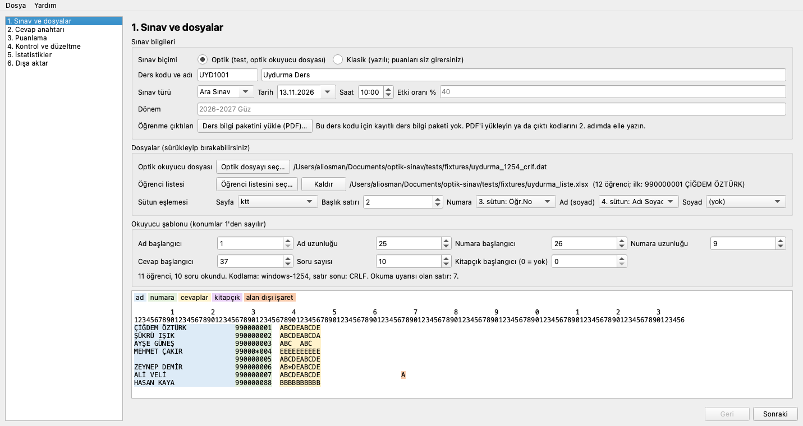
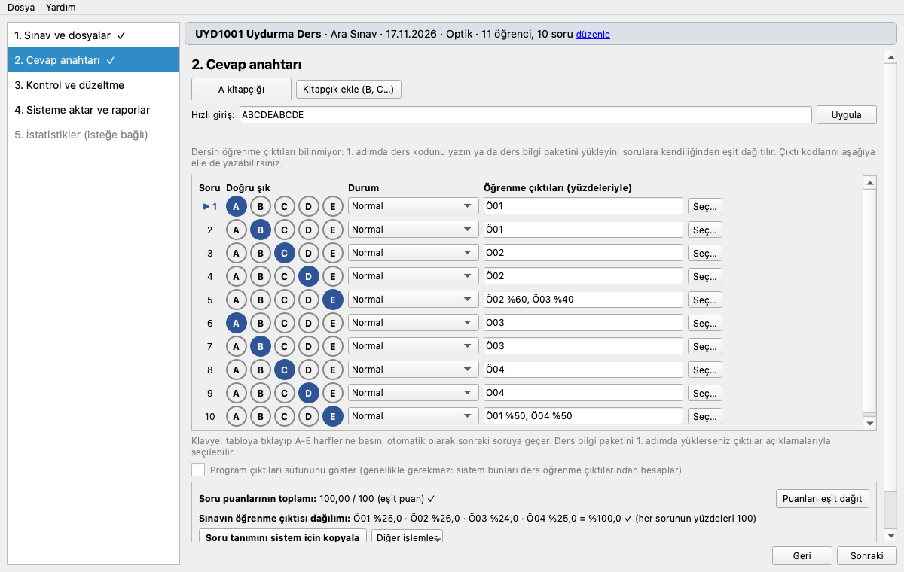
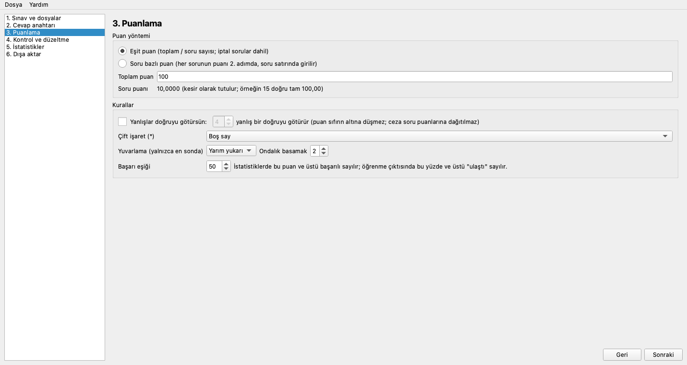
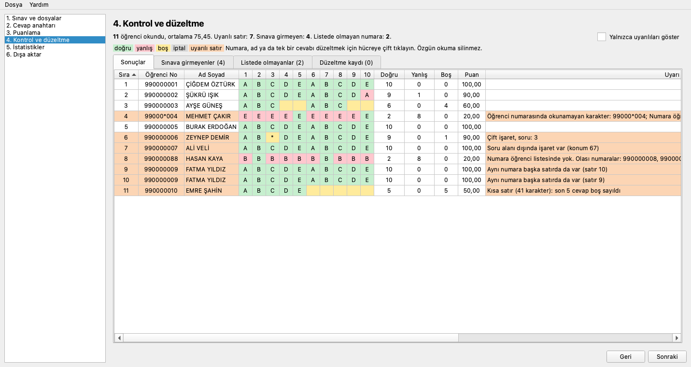
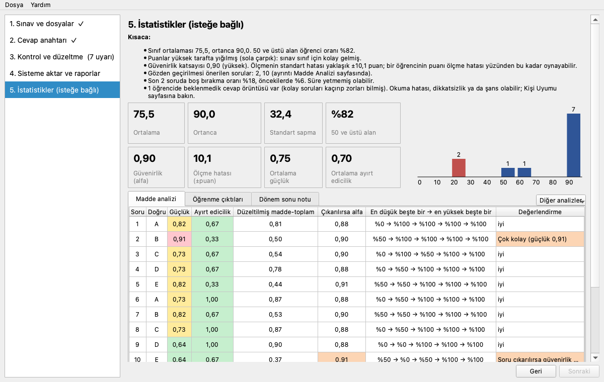
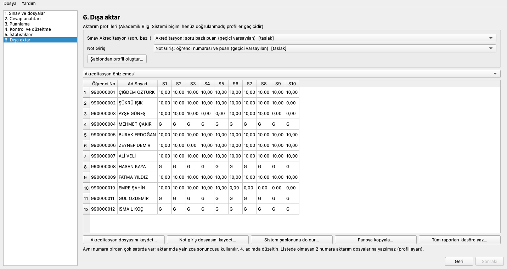

# Optik Sınav Değerlendirme

## ⬇️ İndir

### 👉 [İndirme sayfası](https://fabricandofitfaber.github.io/optik-sinav/): bilgisayarınızı tanır, doğru dosyayı gösterir

| | Ne indirmeliyim? | Kimin için |
|---|---|---|
| 🌐 | **[Tarayıcıda hemen aç](https://fabricandofitfaber.github.io/optik-sinav/uygulama.html)** (kurulum yok) · [tek dosya olarak indir](https://github.com/fabricandofitfaber/optik-sinav/releases/latest/download/OptikSinav.html) | Herkes; Mac ve Windows |
| 🍎 | **[Mac (M1, M2, M3, M4…) için indir](https://github.com/fabricandofitfaber/optik-sinav/releases/latest/download/OptikSinav-Mac-AppleSilicon.dmg)** | 2021'den sonra alınan Mac'lerin çoğu |
| 🍎 | [Mac (Intel işlemcili) için indir](https://github.com/fabricandofitfaber/optik-sinav/releases/latest/download/OptikSinav-Mac-Intel.dmg) | Eski Mac'ler |
| 🪟 | **[Windows için kurulum dosyası](https://github.com/fabricandofitfaber/optik-sinav/releases/latest/download/OptikSinav-Windows-Kurulum.exe)** · [kurulumsuz sürüm](https://github.com/fabricandofitfaber/optik-sinav/releases/latest/download/OptikSinav-Windows-Tasinabilir.zip) | Windows 10 ve 11 |

Mac'inizin hangisi olduğunu öğrenmek için: sol üstteki elma menüsü → **Bu Mac Hakkında**. "Çip: Apple M…" yazıyorsa M1-M4 düğmesi, "İşlemci: Intel" yazıyorsa Intel düğmesi. İlk açılışta çıkabilecek güvenlik uyarısının nasıl geçileceği indirme sayfasında ve aşağıdaki "İmzasız uygulama uyarıları" bölümünde anlatılıyor.

---

Optik okuyucudan çıkan ham `.dat` dosyasını (ya da klasik sınavda elle girilen puanları) **soru bazında** puanlayan, okuma hatalarını gösterip düzelttiren ve Muğla Sıtkı Koçman Üniversitesi Akademik Bilgi Sistemi'ne aktarılacak soru tanımını, puan dosyalarını, istatistikleri ve öğrenme çıktısı raporunu üreten program.

İki biçimde gelir; ikisi aynı motoru kullanır ve aynı `.osd` sınav dosyasını açar:

- **Tek dosyalık tarayıcı sürümü (önerilen):** `OptikSinav.html`. Kurulum yok, uyarı yok: dosyaya çift tıklayınca Chrome, Edge, Safari ya da Firefox'ta açılır; Mac'te ve Windows'ta aynıdır. Sayfanın güvenlik kuralı internete bağlanmayı tarayıcı düzeyinde yasaklar; dosyalar yalnızca o bilgisayarda işlenir.
- **Masaüstü uygulaması:** macOS (Apple Silicon ve Intel) ve Windows 10/11 için imzasız paket.
- **Çevrim dışıdır.** Hiçbir sunucuya bağlanmaz; güncelleme denetimi, kullanım verisi toplama ya da çevrim içi yazı tipi yoktur.
- Açık kaynaktır, MIT lisanslıdır.

## Kişisel verilerin korunması

Öğrenci adları, numaraları ve cevapları yalnızca programın çalıştığı bilgisayarda işlenir ve hiçbir yere gönderilmez. Bu, Kişisel Verilerin Korunması Kanunu açısından verinin yalnızca öğretim elemanının kendi bilgisayarında, kendi denetiminde kaldığı anlamına gelir. Depoda gerçek öğrenci verisi yoktur; testler ve ekran görüntüleri uydurma ad ve numaralarla hazırlanmıştır (`tests/fixtures/`).

## Kurulum

### Tarayıcı sürümü

[İndirme sayfasından](https://fabricandofitfaber.github.io/optik-sinav/) "Programı aç" ile kurulumsuz kullanın ya da [`OptikSinav.html`](https://github.com/fabricandofitfaber/optik-sinav/releases/latest/download/OptikSinav.html) dosyasını indirip çift tıklayın. Başka bir şey gerekmez. Son çalışma o tarayıcıda saklanır; **Kaydet** düğmesi sınavı, optik dosya ve öğrenci listesi içine gömülü olarak tek bir `.osd` dosyasına indirir. Excel dosyaları tarayıcının İndirilenler klasörüne düşer. Excel içinde grafik yoktur; grafikler "Yazdırılabilir rapor"dadır.

Kaynaktan derlemek için: `python tools/web_derle.py` → `web/dist/OptikSinav.html`.

### Masaüstü uygulaması

[Sürümler](../../releases) sayfasından işletim sisteminize uygun dosyayı indirin.

| Sistem | Dosya |
|---|---|
| macOS, Apple Silicon (M1 ve sonrası) | [`OptikSinav-Mac-AppleSilicon.dmg`](https://github.com/fabricandofitfaber/optik-sinav/releases/latest/download/OptikSinav-Mac-AppleSilicon.dmg) |
| macOS, Intel | [`OptikSinav-Mac-Intel.dmg`](https://github.com/fabricandofitfaber/optik-sinav/releases/latest/download/OptikSinav-Mac-Intel.dmg) |
| Windows 10/11 | [`OptikSinav-Windows-Kurulum.exe`](https://github.com/fabricandofitfaber/optik-sinav/releases/latest/download/OptikSinav-Windows-Kurulum.exe) ya da kurulumsuz [`OptikSinav-Windows-Tasinabilir.zip`](https://github.com/fabricandofitfaber/optik-sinav/releases/latest/download/OptikSinav-Windows-Tasinabilir.zip) |

### İmzasız uygulama uyarıları

Uygulama bir geliştirici sertifikasıyla imzalanmadığı için ilk açılışta işletim sistemi uyarı verir.

- **macOS:** `.dmg` dosyasını açıp uygulamayı Uygulamalar klasörüne sürükleyin. İlk açılışta uygulamaya **sağ tıklayın ve "Aç"** seçin, çıkan pencerede yine "Aç" deyin. Bu yalnızca bir kez gerekir. (macOS 15 ve sonrasında uyarıdan sonra Sistem Ayarları > Gizlilik ve Güvenlik bölümündeki "Yine de Aç" düğmesi kullanılır.)
- **Windows:** SmartScreen uyarısında **"Ek bilgi"** bağlantısına, ardından **"Yine de çalıştır"** düğmesine tıklayın.

### Kaynaktan çalıştırma

Python 3.11 ya da üstü gerekir.

```bash
python -m venv .venv
source .venv/bin/activate        # Windows: .venv\Scripts\activate
pip install -e ".[gelistirme]"
python -m optik_sinav            # arayüz
```

## Kullanım

Program tek pencerede, soldaki altı adımla ilerler. Optik (test) ve klasik (yazılı) sınavlar desteklenir. Bir adımın zorunlu bilgileri tamamlanmadan "Sonraki" düğmesi etkinleşmez; eksik olan alt satırda yazar. `Ctrl+Enter` bir sonraki adıma geçer.

### 1. Sınav ve dosyalar



Önce **sınav biçimini** seçin: *Optik* (optik okuyucu dosyası) ya da *Klasik* (yazılı sınav; soru sayısını girersiniz, öğrenci listesi zorunludur, optik dosya istenmez).

**Ders bilgi paketi:** "Ders bilgi paketini yükle (PDF)" ile Akademik Bilgi Sistemi'nden indirilen ders bilgi paketini gösterin (pencereye sürükleyip bırakmak da olur). Dersin öğrenme çıktıları, program çıktıları, katkı düzeyleri ve değerlendirme ağırlıkları okunur ve ders koduna göre saklanır; ders kodu bir dahaki sefere kendiliğinden tanınır. UTL4513, EKF3005 ve EKF4507 paketle birlikte gelir.

Ders kodu, ders adı, sınav türü, tarih, saat ve etki oranı isteğe bağlıdır; yalnızca raporlarda ve dosya adlarında görünür. Adımlar arasında serbestçe dolaşabilirsiniz; eksik bir şey varsa altta yazar, tamamlanan adımların yanında ✓ görünür. Optik dosyayı ve (isteğe bağlı) öğrenci listesini seçin ya da pencereye sürükleyip bırakın. Program soru sayısını kendisi önerir; alan konumları ve soru sayısı "Okuyucu şablonu" bölümünden değiştirilebilir. Önizlemede ad, numara ve cevap alanları ayrı renklerle, alan dışındaki işaretler turuncu ile görünür. Öğrenci listesinde numara ve ad sütunları tahmin edilir; yanlışsa "Sütun eşlemesi" satırından düzeltin.

Kabul edilen öğrenci listeleri: Akademik Bilgi Sistemi'nden indirilen Excel listesi, eski optik okuma yazılımının Excel çıktısı, akreditasyon şablonunun kendisi, numara ve ad içeren `.csv` dosyası ya da **sınav yoklama listesi PDF'i**. PDF'te her satırdaki 6-12 haneli numara ve yanındaki ad okunur; taranmış (resim) PDF okunamaz. Okunan öğrenci sayısını ve sütunları kontrol edin.

**Klasik sınavda** liste yüklenince "Puan girişine geç" düğmesi çıkar; öğrenciler satır, sorular sütun olarak açılır. Soru puanlarını girmediyseniz toplam puan sorulara eşit dağıtılır (2. adımda değiştirebilirsiniz).

**Otomatik kayıt:** girdiğiniz her puan ve yaptığınız her değişiklik birkaç saniye içinde kendiliğinden kaydedilir. Bilgisayarı kapatıp programı yeniden açtığınızda "Kaldığınız yerden devam edilsin mi?" diye sorulur; liste dosyası taşınmış ya da silinmiş olsa bile çalışma kayıttaki kopyadan geri gelir. Sınavı bir dosyaya kaydettiyseniz ("Kaydet") o dosya da kendiliğinden güncel tutulur. "Hayır" ya da "Yeni sınav" derseniz eski çalışma silinmez, yedek klasörüne alınır. Tarayıcı sürümü son çalışmayı tarayıcının kendisinde saklar ve sayfa açılınca geri yükler.

### 2. Cevap anahtarı



Şıklar optik formdaki gibi **yuvarlak düğmelerdir**; tıklayarak işaretleyin. Daha hızlısı: soru tablosuna bir kez tıklayın ve klavyeden A-E harflerine basın; her harf o sorunun şıkkını seçip sonraki soruya geçer (Boşluk ya da Sil temizler, oklar soru değiştirir). Hızlı giriş satırına bütün anahtarı yazıp Enter'a basmak da olur (`-` soruyu atlar). Her soru için durum seçilebilir: **Normal**, **İptal** (herkese tam puan) ya da **Birden fazla doğru**.

**Soru puanları:** her satırda puan kutusu vardır. Değiştirdiğiniz anda soru bazlı puana geçilir ve öteki sorular toplamı tutacak şekilde dolar; alt satırda toplamın tutup tutmadığı görünür. "Puanları eşit dağıt" eşit puana döner.

**Öğrenme çıktıları ve %100 kuralı:** her sorunun ölçtüğü çıktıları "Seç…" düğmesiyle (açıklamalarıyla birlikte) ya da satıra yazarak girin: `1, 3` yazmak Ö01 ve Ö03'e yarı yarıya demektir; `Ö02 %60, Ö03 %40` yüzdeleri kendiniz verir. Her sorunun yüzdeleri tam 100 etmeli; etmezse ya da çıktısı seçilmemiş soru varsa alt satırda kırmızı uyarı çıkar ve sonraki adıma geçilmez (Akademik Bilgi Sistemi de %100 olmayan dağılımı kabul etmiyor). Alt satır sınavın bütününün çıktılara dağılımını da gösterir (toplam %100). "Bütün sorulara çıktıyı sırayla dağıt" hızlı bir başlangıç verir; "Ders eşlemesini kaydet" eşlemeyi sonraki sınavlar için saklar.

**A ve B kitapçığı:** "Kitapçık ekle" ile B (C…) kitapçığı açılır. B sekmesinde şıkları B'nin kendi soru sırasıyla işaretleyin ve "Ana kitapçıktaki karşılığı" sütununa sorunun A'da kaçıncı soru olduğunu yazın (sıra aynıysa dokunmayın). Puan, durum ve öğrenme çıktısı A'dan gelir; bütün çıktılar A'nın soru numaralarıyla verilir. Öğrencinin kitapçığı optik formdan okunur (1. adımda "Kitapçık başlangıcı"); okunamazsa 4. adımda Kitapçık sütununa çift tıklayarak seçilir.

**Klasik sınavda** bu adımın adı "Sorular ve puanlar"dır; şık yoktur, her sorunun puanını ve öğrenme çıktılarını girersiniz. En hızlısı üstteki **Soru puanları** satırıdır: `10 10 10 10 20 40` yazıp Enter'a basınca soru sayısı 6 olur ve puanlar yerleşir. Tek bir puanı kutusuna tıklayıp da değiştirebilirsiniz. "+ Soru ekle" ve "− Son soruyu çıkar" düğmeleri tablonun altındadır; çıkarılan soruya öğrenci puanı girilmişse onay sorulur ve puanlar silinmez (soru geri eklenince geri gelir). Toplam tutmazsa kaç puan eksik ya da fazla olduğu yazar.

### 3. Puanlama



- **Eşit puan:** soru puanı = toplam / soru sayısı (iptal sorular dahil). Puanlar kesir olarak tutulur, **yuvarlama yalnızca en sonda** yapılır; 15 doğru tam 100 eder.
- **Soru bazlı puan:** her sorunun puanı 2. adımdaki soru satırında girilir, toplamın tam puana eşitliği denetlenir.
- **Başarı eşiği** (varsayılan 50): istatistiklerde bu puan ve üstü başarılı, öğrenme çıktısında bu yüzde ve üstü "ulaştı" sayılır.
- **Yanlışlar doğruyu götürsün** (varsayılan kapalı): net = doğru - yanlış / oran; puan sıfırın altına düşmez. Ceza soru puanlarına dağıtılmaz; akreditasyon dosyasında soru bazında ham puan kullanılır.
- **Çift işaret (`*`):** varsayılan olarak boş sayılır, istenirse yanlış sayılır.
- Yuvarlama: yarım yukarı, aşağı ya da yukarı; ondalık basamak sayısı seçilebilir.

### 4. Kontrol ve düzeltme



Doğru yeşil, yanlış kırmızı, boş sarı, iptal gri görünür; uyarılı satırlar turuncudur. "Yalnızca uyarılıları göster" ile süzün. Numara, ad ya da tek bir cevabı düzeltmek için hücreye çift tıklayın (ya da Enter'a basın). **Özgün okuma hiçbir zaman silinmez**; her düzeltme "kim, ne zaman, eski değer, yeni değer" olarak kaydedilir ve sonuç dosyasında ayrı bir sayfada yer alır.

**Klasik sınavda** bu adımın "Puan girişi" sekmesinin üstünde **kâğıt sırasıyla giriş** paneli vardır: öğrencinin numarasını ya da adının birkaç harfini yazıp Enter'a basın, soru puanlarını yazın (Enter bir sonraki kutuya geçer), isterseniz kâğıdın üstündeki toplamı da yazın; son kutuda Enter kaydeder ve yeni kâğıda hazırlar. Kâğıttaki toplam soru puanlarının toplamıyla tutmazsa uyarılır. Altında da öğrenci listesi ve soru sütunları vardır: hücreye tıklayıp puanı yazın, ya da Excel'den bir bloğu kopyalayıp yapıştırın (Ctrl+V / Cmd+V). "Excel'den puan al" numara ve S1, S2… sütunları olan bir dosyayı okur; "Boş puan şablonu oluştur" doldurulacak Excel'i üretir. Tam puan yeşil, kısmi puan mavi, sıfır kırmızı, sorunun puanını aşan değer turuncu görünür. Hiç puanı girilmeyen öğrenci sınava girmemiş sayılır.

Uyarı türleri: numarada okunamayan karakter, boş ad, Türkçe karakteri bozuk ad, kısa satır, soru alanı dışında işaret, çift işaret, geçersiz işaret, aynı numaranın iki kez okunması, listede olmayan numara. Listede olup dosyada olmayan öğrenciler "Sınava girmeyenler" sekmesinde, eşleşmeyen numaralar olası numara önerileriyle "Listede olmayanlar" sekmesinde görünür. Numara uzunlukları farklı olabileceği için (9 ve 10 hane) **otomatik eşleştirme yapılmaz**; doğru numarayı siz seçersiniz. Doğru ad her zaman öğrenci listesinden alınır.

### 5. İstatistikler



Sayıların sade Türkçe yorumu, temel değerler (ortalama, ortanca, standart sapma, başarılı oranı, güvenirlik, ölçme hatası, ortalama güçlük ve ayırt edicilik), eşiğin altı kırmızı olan puan dağılımı grafiği ve sekmeler:

- **Madde analizi:** güçlük, ayırt edicilik, düzeltilmiş madde-toplam korelasyonu, "soru çıkarılırsa güvenirlik", beş başarı grubunda doğru oranı (iyi soruda soldan sağa artar) ve sorunlu soru açıklaması.
- **Öğrenme çıktıları:** her çıktının sınavdaki payı, sınıf başarısı ve eşiğe ulaşan öğrenci oranı.
- **Kişi uyumu:** kolay soruları kaçırıp zor soruları bilen öğrenciler (okuma hatası, dikkatsizlik ya da şans; kâğıda bakın).
- **Benzer cevaplar:** sınıf geneline göre olağandışı sayıda aynı yanlış şıkkı işaretleyen öğrenci çiftleri. Yalnızca istatistiksel işarettir, kopya kanıtı değildir.

Ayrıca: **Kavram yanılgıları** (iki sorunun yanlış şıklarını birlikte seçen öğrenciler; şansla açıklanamayanlar), **Sınav yapısı** (sınav tek bir beceriyi mi ölçüyor, hangi soru ayrışıyor, öğrenme çıktısı eşlemesi verilerle uyumlu mu) ve **Dönem sonu notu** (final puanlarını girin ya da Excel'den alın; mutlak ya da T-puanına dayalı bağıl değerlendirmeyle harf notu, geçen ve kalanlar, bir üst harfe 1 puandan az kalanlar; harf tabloları örnektir, yönetmeliğinizle karşılaştırın). 6. adımdaki **Öğrenci karneleri** her öğrenciye bir sayfa üretir: puan, sıra, öğrenme çıktısı başarısı ve soru soru sonuç.

Bunlara ek olarak Excel raporunda çeldirici analizi (her yanlış şıkkın üst ve alt gruptaki seçilme oranı, işlemeyen çeldiriciler), soru sırasına göre boş bırakma (süre yetti mi), çarpıklık, basıklık, çeyrekler ve z ile T puanları bulunur.

### 6. Dışa aktar



- **Profil seçimi ve önizleme:** Sınav Akreditasyon (soru bazlı) ve Not Giriş için birer profil seçilir, ilk satırlar önizlenir.
- **Sistem şablonunu doldur:** sistemden indirdiğiniz şablonun içine, şablondaki öğrenci sırası korunarak puanlar yazılır. En güvenli doğrudan giriş yolu budur.
- **Panoya kopyala:** web ekranında tablo halinde giriş varsa seçili sütunlar sistemdeki öğrenci sırasıyla sekmeyle ayrılmış olarak kopyalanır; sistemdeki tablonun ilk hücresine yapıştırın.
- **Tüm raporları klasöre yaz:** aşağıdaki dosyaların hepsi tek seferde yazılır.

Dosya adlarında ders kodu, sınav türü ve tarih bulunur, örneğin `UTL4513_AraSinav_2026-11-10_sonuc.xlsx`.

| Dosya | İçerik |
|---|---|
| `..._sonuc.xlsx` | Sonuç (soru puanları, doğru, yanlış, boş, puan, uyarı), Cevaplar, Uyarılar, Düzeltme Kaydı, Anahtar ve Ayarlar sayfaları. Renkli, süzgeçli, ilk satır sabit. |
| `..._akreditasyon.xlsx` | Soru bazlı puanlar, seçili profile göre |
| `..._akreditasyon_sablon.xlsx` | Sistem şablonu verildiyse doldurulmuş şablon |
| `..._not_giris.xlsx` | Öğrenci numarası ve puan, seçili profile göre |
| `..._istatistik.xlsx` | Grafikli istatistik raporu: Özet ve yorum, Puan Dağılımı (grafik), Madde Analizi (grafik), Çeldiriciler, Beş Grup, Boş Bırakma (grafik), Kişi Uyumu, Benzer Cevaplar, Standart Puanlar. Her sayfanın altında okuma rehberi var. |
| `..._ogrenme_ciktisi.xlsx` | Soru-Çıktı Eşlemesi (sisteme girilecek yüzde tablosu, her satır 100), Sınav Dağılımı (toplam 100, tam sayıya yuvarlanmışı da), Sınıf Başarısı (grafik), Öğrenci Bazında |
| `..._ozet.pdf` | Sınav bilgileri, puan dağılımı grafiği ve madde analizi tablosu (arşiv ve bölüm dosyası için) |

Sınav ayarları, cevap anahtarı, düzeltmeler ve kaynak dosya yolları `.osd` uzantılı tek bir proje dosyasında saklanır (Dosya > Kaydet). Dosya > Son açılanlar menüsünden devam edilebilir.

## Sistem şablonundan profil oluşturma

Akademik Bilgi Sistemi'nin soru bazlı not giriş ekranının ve toplu aktarım dosyasının biçimi henüz görülemediği için gelen profiller **geçicidir** (listede "[taslak]" yazar). Gerçek biçime uymak için:

1. Sistemde ilgili sınavın öğrenci listesini ya da boş şablonunu Excel olarak indirin.
2. 5. adımda **"Şablondan profil oluştur…"** düğmesine basıp dosyayı gösterin.
3. Program başlık satırını, numara ve ad sütunlarını, soru sütunlarını (`S1`, `Soru 1`, `1` gibi) ve toplam puan sütununu tanıyıp bir profil önerir. Profil adını, sınava girmeyenlerin gösterimini (boş, `G`, `GR`, `-1` gibi) ve ondalık basamağı onaylayıp kaydedin.
4. **"Sistem şablonunu doldur…"** ile puanlar şablonun içine yazılır; şablonda olup sınava girmeyenler ve sonuçta olup şablonda olmayan numaralar ayrıca bildirilir.

Profiller JSON dosyalarıdır. Gelenler `profiles/` klasöründe, kullanıcının kaydettikleri uygulama veri klasöründedir (macOS: `~/Library/Application Support/OptikSinav/profiles`, Windows: `%APPDATA%\OptikSinav\profiles`). Bir profil şunları belirler: dosya türü (`xlsx`, `csv`, `txt` ya da `sablon`), sayfa adı, üst satırlar, sütunlar ve başlıkları, öğrenci numarasının metin mi sayı mı yazılacağı, ondalık ayırıcı ve basamak sayısı, yuvarlama yöntemi, sınava girmeyen gösterimi, kodlama, ayraç ve satır sonu.

## Optik dosya biçimi

Varsayılan okuyucu şablonu (`readers/varsayilan_136.json`): sabit genişlikli satır, ad 1-25, numara 26-34, cevaplar 37'den başlar; `A`-`E` şık, boşluk boş, `*` çift işaret. Başlık satırı, cevap anahtarı ve kitapçık alanı yoktur. Kodlama ve satır sonu (CRLF ya da LF; UTF-8, Windows-1254 ya da Latin-1) kendiliğinden algılanır. Ad alanı asıl kaynak sayılmaz; eşleştirme öğrenci numarasıyla yapılır.

## Komut satırı

Arayüz olmadan da çalışır (test ve toplu işlem için):

```bash
python -m optik_sinav puanla --dat sinav.dat --anahtar BEDACDEDBCBEAAC --liste liste.xlsx --cikti sonuclar/ --ders-kodu UTL4513 --sinav-turu "Ara Sınav" --tarih 2026-11-10
```

```bash
python -m optik_sinav onizle --dat sinav.dat
```

Diğer seçenekler: `--iptal 3,7`, `--coklu 5=AC`, `--cift-isaret yanlis`, `--ceza 4`, `--yuvarlama asagi`, `--sablon sistem_sablonu.xlsx`, `--proje sinav.osd`, `--proje-kaydet sinav.osd`, `--ayrintili`. Tam liste için `python -m optik_sinav puanla --help`.

## Geliştirme

```bash
QT_QPA_PLATFORM=offscreen python -m pytest -q        # testler
python tools/fixture_uret.py                         # uydurma test dosyaları
QT_QPA_PLATFORM=offscreen python tools/simge_uret.py  # simgeler
pyinstaller --noconfirm optik_sinav.spec             # paket
```

Puanlama motoru (`src/optik_sinav/core/`) arayüzden bağımsızdır ve saf fonksiyonlardan oluşur. Bir `v*` etiketi gönderildiğinde GitHub Actions testleri macOS ve Windows'ta çalıştırır, paketleri üretir ve Sürümler sayfasına ekler.

## Bilinen sınırlamalar

- Optik ve klasik bölümü birlikte olan karma sınav henüz desteklenmiyor.
- Akademik Bilgi Sistemi'nin öğrenci puanı ve not giriş ekranları için hazırlanan aktarım dosyaları örnek biçimdedir; sisteme yüklemeden önce bir öğrencinin satırını ekranla karşılaştırın. Soru tanımı aktarımı (2. adım) sistemin kendi ekranına göre hazırlanmıştır.
- Dönem sonu notundaki harf tabloları örnektir; kendi üniversitenizin yönetmeliğine göre değiştirin.
- Komut satırı sürümü klasik sınavı ve kitapçıkları desteklemiyor; bunlar için uygulamayı kullanın.

Bir hata görürseniz ya da bir öneriniz varsa [GitHub'da bildirin](https://github.com/fabricandofitfaber/optik-sinav/issues).

## Üçüncü taraf kitaplıklar

Tarayıcı sürümüne şu kitaplıklar gömülüdür (sürümler sabittir, `web/vendor/SHA256SUMS`): SheetJS Community Edition 0.18.5 (Apache 2.0), ExcelJS 4.4.0 (MIT), PDF.js 3.11.174 (Apache 2.0).

## Lisans

[MIT lisansı](LICENSE) ile yayımlanmıştır. Kısaca: programı ücretsiz kullanabilir, kopyalayabilir, değiştirebilir ve başkalarıyla paylaşabilirsiniz; paylaşırken lisans metnini ve telif satırını korumanız yeterlidir. Program "olduğu gibi" sunulur, hiçbir garanti verilmez: sisteme aktarmadan önce puanları kontrol etmek kullanıcının sorumluluğundadır. Bağlayıcı olan, `LICENSE` dosyasındaki İngilizce metindir.

Telif hakkı © 2026 Ali Osman Öztop.
